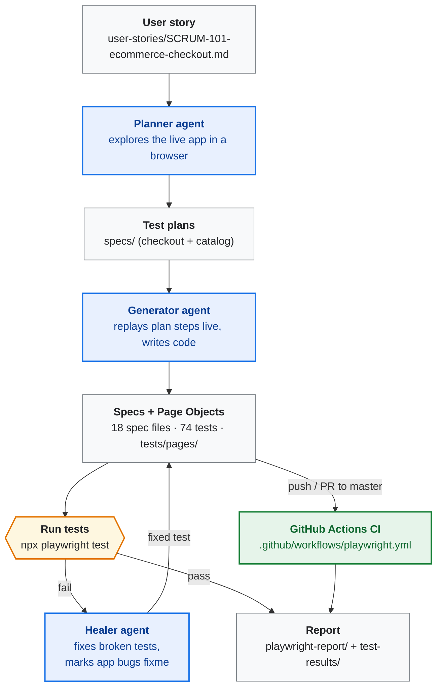
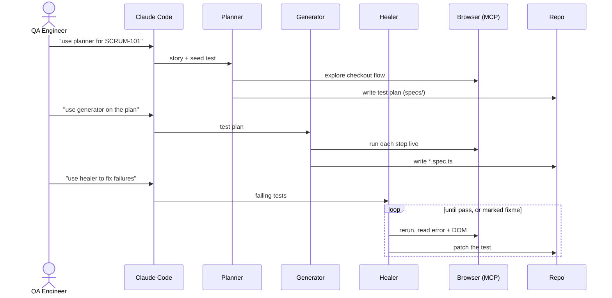
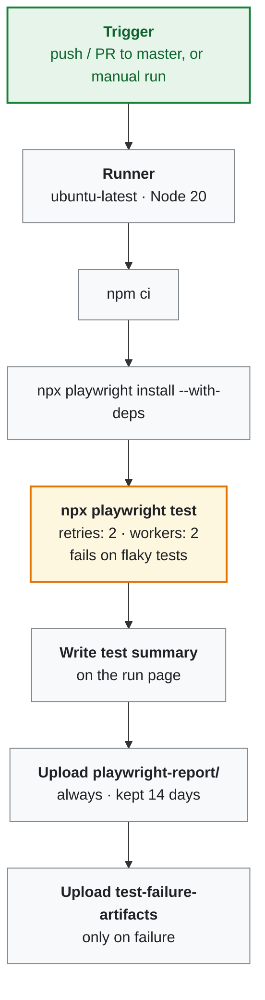
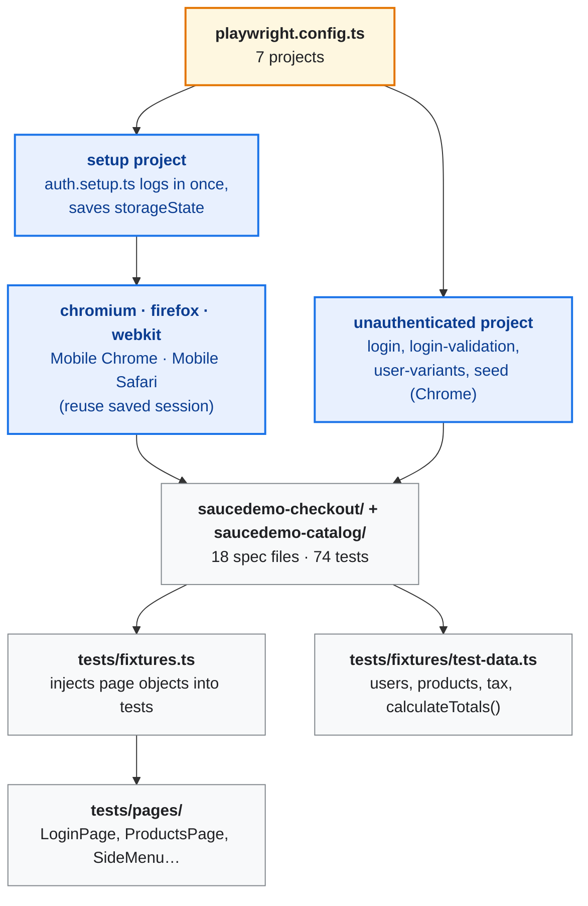

# AgentE2EQAWorkflow-Playwright

A worked example of an **AI-agent-driven QA workflow** built on [Playwright Test Agents](https://playwright.dev/docs/test-agents): a user story is turned into a test plan (**planner**), the plan into Playwright tests (**generator**), the tests run across browsers and devices, and failures are fixed or flagged (**healer**). The app under test is the [SauceDemo](https://www.saucedemo.com) e-commerce demo site.

- **Target application:** https://www.saucedemo.com (Sauce Labs' public e-commerce demo)
- **Test login:** `standard_user` / `secret_sauce`
- **Features under test:** SCRUM-101 checkout flow, plus catalog, navigation and the special test users

---

## 1. The workflow



Blue boxes are AI agents, green is CI.

| Stage | Input | Who does it | Output |
|---|---|---|---|
| 1. Requirements | Feature idea | Human / PO | [user-stories/SCRUM-101-ecommerce-checkout.md](user-stories/SCRUM-101-ecommerce-checkout.md) |
| 2. Plan | User story + live app | **Planner** agent | [checkout plan](specs/saucedemo-checkout-test-plan.md), [catalog & navigation plan](specs/saucedemo-catalog-navigation-test-plan.md) |
| 3. Generate | Test plan | **Generator** agent | `tests/saucedemo-checkout/` (40 tests), `tests/saucedemo-catalog/` (34 tests) |
| 4. Execute | Specs | Playwright runner | Pass/fail + traces, screenshots, videos |
| 5. Heal | Failing tests | **Healer** agent | Fixed specs, or `test.fixme()` for real app bugs |
| 6. Report | Results | Agent / human | [test-results/SCRUM-101-checkout-test-report.md](test-results/SCRUM-101-checkout-test-report.md), HTML report |
| 7. CI | Push / PR | GitHub Actions | HTML report artifact |

In more detail:

1. **User story:** [user-stories/SCRUM-101-ecommerce-checkout.md](user-stories/SCRUM-101-ecommerce-checkout.md) is a standard agile story. It has 5 Gherkin-style acceptance criteria (AC1–AC5), business rules, technical notes and a Definition of Done.
2. **Test plan:** the planner agent explores the live app and writes a plan to `specs/`. Each scenario has steps, expected results and a target spec file.
3. **Tests:** the generator agent replays each plan step in a real browser and writes the Playwright/TypeScript spec.
4. **Run and heal:** `npm test` runs the suite. The healer agent debugs failures. It fixes broken tests, and marks the test `test.fixme()` with an explanation when the app itself is broken.
5. **Report:** the HTML report from every run. [test-results/SCRUM-101-checkout-test-report.md](test-results/SCRUM-101-checkout-test-report.md) is the write-up of the first cycle (historical).

---

## 2. Folder structure

```
QA_End2End_UsingPlaywrightAgents/
├── README.md                     # this file
├── package.json                  # dependencies + npm scripts
├── playwright.config.ts          # projects, baseURL, reporters, auth setup wiring
├── tsconfig.json
├── .env.example                  # optional BASE_URL / credential overrides
├── .mcp.json                     # Playwright MCP server used by the agents
├── .claude/agents/               # planner, generator, healer agent definitions
├── .github/
│   ├── workflows/playwright.yml  # CI
│   └── scripts/test-summary.mjs  # writes the CI run summary
├── docs/
│   └── AGENT_WORKFLOW.docx       # Word version of the workflow guide
├── user-stories/
│   └── SCRUM-101-ecommerce-checkout.md
├── specs/
│   ├── saucedemo-checkout-test-plan.md             # SCRUM-101 plan (10 scenario groups)
│   └── saucedemo-catalog-navigation-test-plan.md   # catalog/navigation/users plan (7 groups)
├── tests/
│   ├── seed.spec.ts              # seed the agents start from (logs in as standard_user)
│   ├── fixtures.ts               # custom test/expect, injects page objects
│   ├── fixtures/
│   │   ├── test-data.ts          # users, products, tax rate, helpers
│   │   └── auth.setup.ts         # "setup" project: logs in once, saves the session
│   ├── pages/                    # Page Object Model
│   │   ├── LoginPage.ts, ProductsPage.ts, ProductDetailsPage.ts, SideMenu.ts
│   │   ├── CartPage.ts, CheckoutInfoPage.ts, CheckoutOverviewPage.ts
│   │   └── CheckoutCompletePage.ts
│   ├── saucedemo-checkout/       # 11 spec files, 40 tests (SCRUM-101)
│   └── saucedemo-catalog/        # 7 spec files, 34 tests
└── test-results/
    └── SCRUM-101-checkout-test-report.md   # original execution report (historical)
```

`node_modules/`, `playwright-report/`, `test-results/artifacts/` and `playwright/.auth/` are generated when you run the tests and are git-ignored.

---

## 3. How to run the project

### 3.1 Prerequisites

- **Node.js 20+** (CI uses Node 20) and npm
- Git
- Internet access: the tests run against the live https://www.saucedemo.com

### 3.2 Install

```bash
git clone https://github.com/rupeshpjadhav/QA_End2End_UsingPlaywrightAgents.git
cd QA_End2End_UsingPlaywrightAgents
npm ci                          # installs @playwright/test and TypeScript from package-lock.json
npx playwright install          # downloads Chromium, Firefox and WebKit
                                # on Linux/CI use: npx playwright install --with-deps
```

### 3.3 Run the tests

```bash
npm test                        # everything: all 7 projects (see 3.6)
```

Expected result: **277 passed, 27 skipped, 0 failed** (about 2 minutes). The skips are intentional:

- mobile-only tests skip on desktop projects, and the desktop smoke test skips on mobile;
- tests marked `test.fixme()` describe **known defects in SauceDemo itself** (see section 8). Each has a comment explaining the defect. Remove `fixme` to check whether a defect has been fixed.

Narrower runs:

```bash
npm run test:chromium                         # desktop Chrome only (plus setup)
npm run test:firefox
npm run test:webkit
npm run test:mobile                           # Pixel 7 + iPhone 14 emulation
npx playwright test tests/saucedemo-catalog   # one folder
npx playwright test -g "Product Sorting"      # tests whose title matches
npm run test:headed                           # watch the browser
npm run test:ui                               # Playwright UI mode (time-travel debugging)
npm run test:debug                            # step through with the Inspector
```

### 3.4 See the results

```bash
npm run report                  # opens playwright-report/index.html
```

Every run produces:

| Output | What's in it |
|---|---|
| `playwright-report/index.html` | Full HTML report. For each failed test it embeds the **screenshot**, **video** and error context (and the trace, when the test was retried). |
| `test-results/artifacts/` | The same screenshots (`test-failed-1.png`), videos (`video.webm`) and traces as plain files, one folder per failed test. |
| `test-results/results.json` | Machine-readable results (used by CI for the run summary). |

Passing tests keep no screenshots or videos (`screenshot: 'only-on-failure'`, `video: 'retain-on-failure'`). Open a trace with `npx playwright show-trace <path-to-trace.zip>`.

### 3.5 Configuration (optional)

No configuration is needed for the public SauceDemo site. To point at another environment or user, set environment variables when you run the tests:

```bash
BASE_URL=https://staging.example.com SAUCEDEMO_USERNAME=me SAUCEDEMO_PASSWORD=secret npm test
```

[`.env.example`](.env.example) lists the variables. Note: nothing loads a `.env` file automatically, so export the variables in your shell (or your CI settings).

### 3.6 Test projects

Defined in [playwright.config.ts](playwright.config.ts):

| Project | Runs | Session |
|---|---|---|
| `setup` | `tests/fixtures/auth.setup.ts` — logs in once, saves `playwright/.auth/standard_user.json` | — |
| `unauthenticated` | `login`, `login-validation`, `user-variants` and `seed` specs, in Chrome | starts logged out |
| `chromium`, `firefox`, `webkit` | every other spec | reuses the saved session |
| `Mobile Chrome`, `Mobile Safari` | every other spec, on Pixel 7 / iPhone 14 | reuses the saved session |

---

## 4. Test coverage

**74 tests** in 18 spec files (plus the agent seed). Most run in 5 browser/device projects, so a full run executes about 300 tests.

### 4.1 Checkout — SCRUM-101 ([plan](specs/saucedemo-checkout-test-plan.md), `tests/saucedemo-checkout/`)

| # | Scenario group | Spec file | Tests |
|---|---|---|---|
| — | Login (business rule: must be authenticated) | `login.spec.ts` | 4 |
| 1.1 | Complete checkout flow, happy path | `complete-checkout-flow.spec.ts` | 1 |
| 1.2 | Cart review (AC1) | `cart-review.spec.ts` | 5 |
| 1.3 | Checkout information validation (AC2) | `checkout-information-validation.spec.ts` | 5 |
| 1.4 | Order overview (AC3) | `order-overview.spec.ts` | 5 |
| 1.5 | Order completion (AC4) | `order-completion.spec.ts` | 3 |
| 1.6 | Error handling and edge cases (AC5) | `error-handling-edge-cases.spec.ts` | 5 |
| 1.7 | Navigation flows | `navigation-flows.spec.ts` | 4 |
| 1.8 | Price and tax calculation | `price-calculations.spec.ts` | 4 |
| 1.9 | Cross-browser compatibility | `cross-browser-compatibility.spec.ts` | 1 |
| 1.10 | Mobile responsiveness | `mobile-responsiveness.spec.ts` | 3 |
| | **Total** | | **40** |

### 4.2 Catalog, navigation and user variants ([plan](specs/saucedemo-catalog-navigation-test-plan.md), `tests/saucedemo-catalog/`)

| # | Scenario group | Spec file | Tests |
|---|---|---|---|
| 1 | Login validation and access control | `login-validation.spec.ts` | 5 |
| 2 | Product sorting | `product-sorting.spec.ts` | 5 |
| 3 | Product details | `product-details.spec.ts` | 5 |
| 4 | Burger menu and session | `menu-and-session.spec.ts` | 6 |
| 5 | Footer | `footer.spec.ts` | 1 |
| 6 | Dynamic Catalog (spinner, lazy load, slider) | `dynamic-catalog.spec.ts` | 4 |
| 7 | Special test users (simulated defects) | `user-variants.spec.ts` | 8 |
| | **Total** | | **34** |

**Cross-browser and mobile coverage:** you don't write a test once per browser. Instead, the `chromium`, `firefox` and `webkit` projects each run the whole suite. `cross-browser-compatibility.spec.ts` is just a short smoke test that covers plan item 1.9 by name. Similarly, `mobile-responsiveness.spec.ts` skips itself outside the `Mobile Chrome` / `Mobile Safari` projects, which use Playwright's `devices` presets.

---

## 5. Using the AI agents

### 5.1 What Playwright agents are

Playwright (v1.56+) ships three AI agent definitions — **planner**, **generator** and **healer** — that an AI coding assistant (Claude Code, VS Code Copilot, etc.) runs. Each agent is a prompt file plus access to a **Playwright MCP server**, which gives the AI a real browser to click, type, inspect the DOM and run tests.

They are set up once with:

```bash
npx playwright init-agents --loop=claude    # or --loop=vscode / --loop=opencode
```

This generates:

- `.claude/agents/playwright-test-planner.md`, `playwright-test-generator.md`, `playwright-test-healer.md` — the agent prompts and tool permissions
- `.mcp.json` — registers the `playwright-test` MCP server (browser + test-runner tools)
- a **seed test** (`tests/seed.spec.ts`) — the starting point the agents use to set up the page

In this repo these files are committed: [.claude/agents/](.claude/agents/), [.mcp.json](.mcp.json) and [tests/seed.spec.ts](tests/seed.spec.ts). The generated seed was empty. It was changed to log in as `standard_user`, so every agent starts on the Products page. It runs in the `unauthenticated` project, because it logs in itself.

After upgrading `@playwright/test`, re-run `npx playwright init-agents --loop=claude` to refresh the agent definitions. It keeps the existing `tests/seed.spec.ts`.

### 5.2 How to run them

Agents are **triggered manually** from the AI assistant's chat by naming them in a prompt. Claude Code picks the agent from `.claude/agents/` and gives it the MCP browser tools. Nothing triggers them automatically — not git hooks, and not CI.

1. Open Claude Code in the project root. When it asks, **approve the `playwright-test` MCP server** from `.mcp.json`. Claude Code reads that file only at startup, so if you created these files during a session, restart Claude Code first.
2. Ask for an agent by name (prompts below).
3. Review the changes, run `npm test`, then commit.



| Agent | Example prompt | What it does | Output |
|---|---|---|---|
| **Planner** | *"Use the playwright-test-planner agent to plan tests for user-stories/SCRUM-101-ecommerce-checkout.md"* | Runs the seed test, explores the app in a real browser, maps every acceptance criterion to scenarios with steps and expected results | Markdown plan in `specs/` |
| **Generator** | *"Use the playwright-test-generator agent to generate tests for section 2 of specs/saucedemo-catalog-navigation-test-plan.md"* | Runs each plan step in the browser so selectors and assertions are checked against the real DOM, then writes the code | `*.spec.ts` files |
| **Healer** | *"Use the playwright-test-healer agent to fix the failing tests"* | Runs the suite, reads errors, traces and the current page snapshot, finds the root cause, patches the test and reruns. If the app itself is broken, it marks the test `test.fixme()` with a comment instead of hiding the bug | Fixed specs |

### 5.3 Agent cycles in this repo

**Cycle 1: checkout (SCRUM-101).** The planner wrote the [checkout plan](specs/saucedemo-checkout-test-plan.md). The generator wrote the first 5 spec files (20 tests). 18 of 20 passed on the first run, and 20 of 20 after healing (see the [original report](test-results/SCRUM-101-checkout-test-report.md)):

| Failure | Root cause | Healer fix |
|---|---|---|
| `complete-checkout-flow.spec.ts` — payment info not found | Fragile CSS selector `.summary_value` | Changed to `[data-test="payment-info-value"]` / `shipping-info-value` |
| `order-completion.spec.ts` — text mismatch | Expected `"Pony Express"`, the app says `"...as fast as the pony..."` | Assertion changed to `toContainText("pony")` |

The page objects, fixtures and the other 6 checkout specs were added afterwards.

**Cycle 2: catalog and navigation.** The planner explored the site beyond checkout and wrote the [catalog plan](specs/saucedemo-catalog-navigation-test-plan.md). The generator wrote 7 spec files. The first run had 9 failures:

| Failure | Root cause | Healer action |
|---|---|---|
| `product-details.spec.ts` — strict-mode violation after clicking a product image | Timing: the URL changed before the details view replaced the product list | **Fixed the test:** wait for "Back to products" before checking the name. *This patched only the one failing test. The same race later failed "Open details from the product name" in CI. The root-cause fix scopes `ProductDetailsPage` locators to the details view (`.inventory_details`), verified with 375 repeated runs across all browsers.* |
| Reset App State, lazy-load catalog | **Real app bugs:** "Remove" buttons survive a reset; one item is duplicated in every batch | **Marked `test.fixme()`** with a comment |
| 6 special-user tests (`problem_user`, `error_user`, `visual_user`) | **Simulated app bugs:** broken images, broken sorting, wrong product links, failing Add to cart, random prices | **Marked `test.fixme()`** with a comment |

Result: 277 passed, 0 failed, 27 skipped (11 skips are by design, 16 are known-bug runs).

---

## 6. CI



[`.github/workflows/playwright.yml`](.github/workflows/playwright.yml) runs on every push and pull request to `master`, and can be started manually (**Actions → Playwright Tests → Run workflow**). On `ubuntu-latest` with Node 20 it runs `npm ci`, `npx playwright install --with-deps` and `npx playwright test --fail-on-flaky-tests`. With `CI=true` the config sets `forbidOnly`, **2 retries** and 2 workers. Because of `--fail-on-flaky-tests`, a test that fails and then passes on retry still **fails the build**; the retry only provides the trace and confirms the test is flaky rather than broken. Traces are recorded on the first retry, and screenshots and video on failure.

After the tests, even if they failed, the workflow:

1. **Writes a test summary** on the run page (**Actions → the run → Summary**): passed / failed / flaky / skipped counts, plus a table of every failed or flaky test with its error. It's built by [.github/scripts/test-summary.mjs](.github/scripts/test-summary.mjs) from `test-results/results.json`. Failures also appear as annotations on the commit or PR.
2. **Uploads the HTML report** as the `playwright-report` artifact (kept 14 days), with screenshots and videos of failed tests embedded.
3. **Uploads `test-failure-artifacts`** (only when something failed): the raw screenshots, videos and traces from `test-results/artifacts/`.

CI only runs tests, not the AI agents. To heal failures, download the report, run the healer agent locally, and push the fix.

---

## 7. Architecture decisions



- **Page Object Model** (`tests/pages/`): each SauceDemo page is a class wrapping its `data-test` locators and the actions on it. Specs call `productsPage.addToCart(key)` or `checkoutInfoPage.fillInfo({...})` instead of repeating raw locators.
- **Custom fixtures** ([tests/fixtures.ts](tests/fixtures.ts)): extends Playwright's `test` so page objects (`loginPage`, `productsPage`, `cartPage`, `sideMenu`, …) are passed straight into test functions.
- **Centralized test data** ([tests/fixtures/test-data.ts](tests/fixtures/test-data.ts)): credentials for every SauceDemo user, the product catalog (name, price, `data-test` key), the 8% tax rate and a `calculateTotals()` helper all live in one module.
- **Authenticated session reuse** ([tests/fixtures/auth.setup.ts](tests/fixtures/auth.setup.ts)): a `setup` project logs in once and saves the session. The browser projects depend on it and reuse its `storageState`, so specs don't repeat login. Specs that must start logged out (login, login validation, the special users and the agent seed) run in the separate `unauthenticated` project.

---

## 8. Known limitations

- **Known SauceDemo defects** are covered by tests marked `test.fixme()`, so they are skipped rather than failing:
  - Reset App State leaves "Remove" buttons until reload.
  - The lazy-load catalog duplicates one item per batch.
  - The special test users have their intended defects:
    - `problem_user`: broken images, sorting doesn't work, product links open the wrong product.
    - `error_user`: an error dialog when sorting, and 3 of 6 "Add to cart" buttons don't work.
    - `visual_user`: random prices.
- **No visual-regression, API, security (XSS/SQL-injection) or performance tests.** SauceDemo has no real backend API.
- **The tests depend on the live public site.** Heavy parallel runs can occasionally hit a network timeout. Since CI fails on flaky tests, such a timeout now fails the build even if the retry passes. If the run summary shows a network error (e.g. `page.goto: net::ERR_…` or a navigation timeout) rather than an assertion, re-run the job.
- **The historical report** in `test-results/` describes only the first checkout cycle (5 suites, 20 tests), not the current suite. Generate a current one with `npm test` + `npm run report`.
