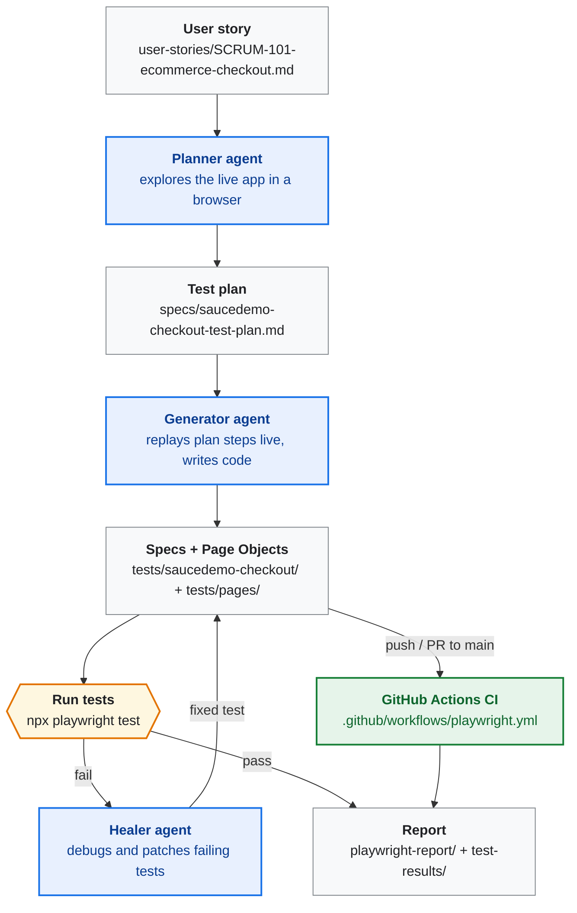
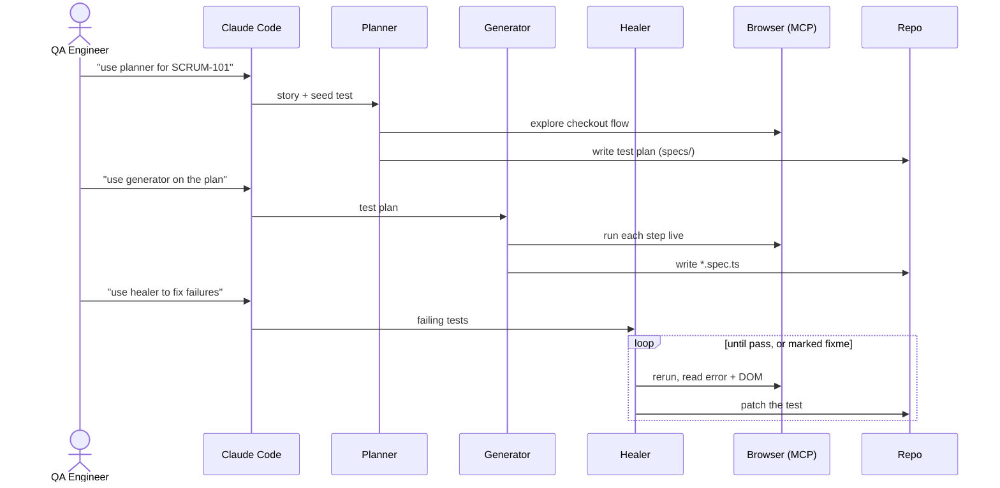
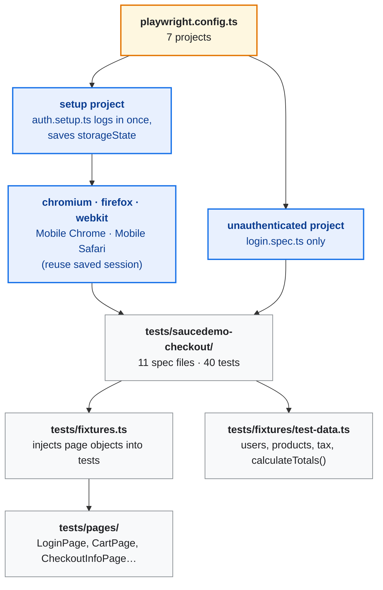
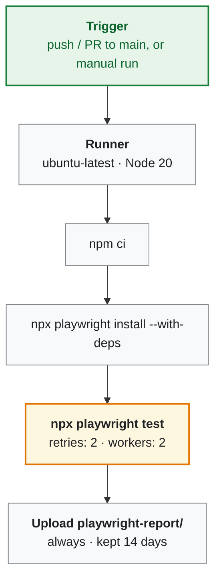

# How This Project Works: Playwright Agents, User Stories to CI

A short guide to how this repo turns a user story into Playwright tests, runs them, fixes ("heals") the ones that fail, and runs them in CI.

---

## 1. The pipeline at a glance



| Stage | Input | Who does it | Output |
|---|---|---|---|
| 1. Requirements | Feature idea | Human / PO | [user-stories/SCRUM-101-ecommerce-checkout.md](../user-stories/SCRUM-101-ecommerce-checkout.md) |
| 2. Plan | User story + live app | **Planner** agent | [specs/saucedemo-checkout-test-plan.md](../specs/saucedemo-checkout-test-plan.md) |
| 3. Generate | Test plan | **Generator** agent | `tests/saucedemo-checkout/*.spec.ts` |
| 4. Execute | Specs | Playwright runner | Pass/fail + traces, screenshots, videos |
| 5. Heal | Failing tests | **Healer** agent | Patched specs |
| 6. Report | Results | Agent / human | [test-results/SCRUM-101-checkout-test-report.md](../test-results/SCRUM-101-checkout-test-report.md), HTML report |
| 7. CI | Push / PR | GitHub Actions | HTML report artifact |

---

## 2. What "Playwright agents" are

Playwright (v1.56+) ships three AI agent definitions — **planner**, **generator**, **healer** — that an AI coding assistant (Claude Code, VS Code Copilot, etc.) runs. Each agent is a prompt file plus access to a **Playwright MCP server**, which gives the AI a real browser to click, type, inspect the DOM, and run tests.

They are set up once with:

```bash
npx playwright init-agents --loop=claude    # or --loop=vscode / --loop=opencode
```

This generates:

- `.claude/agents/playwright-test-planner.md`, `playwright-test-generator.md`, `playwright-test-healer.md` — the agent prompts and tool permissions
- `.mcp.json` — registers the `playwright-test` MCP server (browser + test-runner tools)
- a **seed test** (`tests/seed.spec.ts`) — the starting point the agents use to set up the page (e.g. log in)

> **Note:** These generated files are **not committed to this repo**. The agents were used in an earlier session to produce the plan, the original specs, and the healing pass (the report names `playwright-test-healer`, and the plan still references `tests/seed.spec.ts`). Since then, the seed test has been replaced by the `setup` project in [playwright.config.ts](../playwright.config.ts) + [tests/fixtures/auth.setup.ts](../tests/fixtures/auth.setup.ts). To run the agents again, run `init-agents` above and add a seed test (or point the agents at `auth.setup.ts`).

---

## 3. How each agent is triggered and what it does

Agents are **triggered manually** from the AI assistant's chat by naming them in a prompt. Claude Code picks the agent from `.claude/agents/` and gives it the MCP browser tools. Nothing triggers them automatically — not git hooks, and not CI.



| Agent | Example prompt | What it does | Output |
|---|---|---|---|
| **Planner** | *"Use the planner agent to create a test plan for the checkout flow in user-stories/SCRUM-101…"* | Runs the seed test, explores the app in a real browser, maps every acceptance criterion to scenarios with steps and expected results | Markdown plan in `specs/` |
| **Generator** | *"Use the generator agent to generate tests from specs/saucedemo-checkout-test-plan.md"* | Runs each plan step in the browser so selectors and assertions are checked against the real DOM, then writes the code | `*.spec.ts` files |
| **Healer** | *"Use the healer agent to fix the failing tests"* | Runs the suite, reads errors, traces and the current page snapshot, finds the root cause, patches the test, reruns. If the app itself is broken, it marks the test `test.fixme` instead of hiding the bug | Patched specs |

**Real healing example from this project** (from the [test report](../test-results/SCRUM-101-checkout-test-report.md)) — 18/20 passed at first, 20/20 after healing:

| Failure | Root cause | Healer fix |
|---|---|---|
| `complete-checkout-flow.spec.ts` — payment info not found | Fragile CSS selector `.summary_value` | Changed to `[data-test="payment-info-value"]` / `shipping-info-value` |
| `order-completion.spec.ts` — text mismatch | Expected `"Pony Express"`, the app says `"...as fast as the pony..."` | Assertion changed to `toContainText("pony")` |

---

## 4. How the generated code is organized

After generation, the code was refactored into a maintainable framework:



- **Page Object Model** — each SauceDemo page is a class wrapping its `data-test` locators and actions.
- **Custom fixtures** ([tests/fixtures.ts](../tests/fixtures.ts)) — tests receive `cartPage`, `productsPage`, … as parameters.
- **Auth once, reuse everywhere** — the `setup` project logs in once and the browser projects reuse the session.
- **Cross-browser and mobile** — the browser/device projects each run the whole suite (latest run: 174 passed, 11 skipped by design).

---

## 5. How CI works



Defined in [.github/workflows/playwright.yml](../.github/workflows/playwright.yml):

- **Triggers:** `push` and `pull_request` to `main`, plus manual `workflow_dispatch`.
- **Runs** the full 7-project matrix. When `CI=true`, the config turns on `forbidOnly`, **2 retries** (which handles flaky network calls to the public site), and 2 workers.
- **Evidence:** traces on first retry, plus screenshots and video on failure. The HTML report is uploaded as an artifact **even when tests fail**.
- **CI does not run the AI agents.** It only runs the tests. Healing is a step a developer runs locally: when CI goes red, they download the report, ask the healer agent to fix the failing tests, and push the fix.

---

## 6. Quick start

```bash
npm install && npx playwright install
npm test                 # full matrix
npm run test:chromium    # one browser
npm run test:ui          # interactive UI mode
npm run report           # open the HTML report

# optional: re-enable the AI agents
npx playwright init-agents --loop=claude
```
